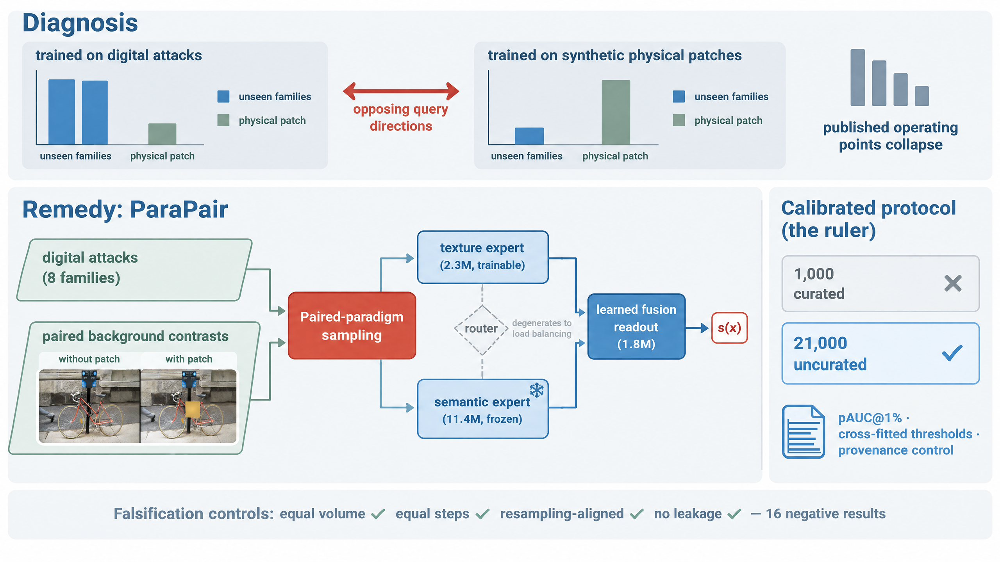

# ParaPairPatchNet

**Paired-paradigm sampling makes physical adversarial patch detection reliable at low false-alarm rates.**

[](https://www.python.org/)
[](https://pytorch.org/)
[](LICENSE)

> Manuscript under double-blind review (Neurocomputing).

This repository contains the training and evaluation code for **ParaPair**:
a lightweight two-branch detector (a frozen semantic expert + a trainable
texture expert) whose training distribution is repaired by **paired-paradigm
sampling** — injecting contrast pairs that share the same background
photograph with and without a real patch texture.



It also ships the **statistically calibrated low-FPR evaluation protocol**
used in the paper: 21,000 uncurated negatives, partial AUC (pAUC) up to the
FPR budget, thresholds chosen by *K*-fold cross-fitting on negatives, a
resampling-provenance control, and the complete log of 16 negative results.

## Main results (calibrated 21k-negative protocol)

| Method | pAUC@1% | TPR@1% (c.f.) | TPR@5% | AUC |
|---|---|---|---|---|
| AdvPatchXAI (CVPR'25) | 0.000 | 0.000 | 0.007 | 0.209 |
| NutNet n13 (CCS'24) | 0.000 | 0.000 | 0.007 | 0.340 |
| NutNet n26 (CCS'24) | 0.000 | 0.000 | 0.000 | 0.342 |
| TruFor (CVPR'23) | 0.000 | 0.000 | 0.050 | 0.509 |
| YOLO26n-cls | 0.056 | 0.113 | 0.446 | 0.866 |
| Sem-only (ours) | 0.040–0.043 | 0.058–0.065 | 0.24–0.30 | 0.833–0.835 |
| MoeAtt (ours, no pairs) | 0.004–0.044 | 0.015–0.065 | 0.14–0.32 | 0.758–0.856 |
| **MoeAtt + ParaPair (ours, 5 seeds)** | **0.149–0.540** | **0.261–0.691** | **0.545–0.891** | 0.909–0.958 |

Every published operating point collapses under the calibrated protocol;
ParaPair restores a 4–12× gain on the hardest metric with equal-step,
equal-volume, resampling-aligned, and leakage controls.

## Datasets

All datasets are public. `code/download_datasets.sh` automates the downloads
that do not require registration and prints instructions for the rest.

| Dataset | Role in the paper | Official source |
|---|---|---|
| **APDE** (ICCV'25) | unseen attack families (zero-shot), second benchmark | [github.com/Gandolfczjh/APDE](https://github.com/Gandolfczjh/APDE) |
| **APRICOT** (ECCV'20, MITRE) | physical patches; calibrated 21k-negative protocol | [apricot.mitre.org](https://apricot.mitre.org/) |
| **APRICOT-Mask** (SAC'22) | pixel-level patch masks | [aiem.jhu.edu/datasets/apricot-mask](https://aiem.jhu.edu/datasets/apricot-mask/) — `ftp://ftp.cis.jhu.edu/pub/apricot-mask` |
| **MS COCO 2017** | uncurated negative pool (20k) + pair backgrounds | [cocodataset.org](https://cocodataset.org/) |
| **INRIA Person** | negatives / pair backgrounds | [pascal.inrialpes.fr/data/human](http://pascal.inrialpes.fr/data/human/) |
| **CASIA v2** | legacy curated negatives (1k pool) | [forensics.idealtest.org](http://forensics.idealtest.org/) |
| **Columbia DVMM** | legacy curated negatives | [ee.columbia.edu/ln/dvmm/downloads](https://www.ee.columbia.edu/ln/dvmm/downloads/) |
| **NIST16 (MFC 2016)** | optional tampering negatives (registration) | [nist.gov — Nimble Challenge 2016](https://www.nist.gov/itl/iad/mig/nimble-challenge-2016-evaluation) |

## Installation

```bash
conda create -n parapair python=3.10 -y
conda activate parapair
pip install -r code/requirements.txt
```

## Reproducing

```bash
# 1) fetch the public datasets (COCO downloads automatically; others print instructions)
bash code/download_datasets.sh

# 2) end-to-end pipeline: feature extraction -> training -> calibrated evaluation -> tables
bash code/run_all.sh
```

Key entry points (all paths relative to `code/`):

| Script | Purpose |
|---|---|
| `experiments_tvc/exp_b_operating_point.py` | calibrated operating points (pAUC / cross-fitted TPR) |
| `experiments_tvc/exp_a_grouped_split.py` | grouped vs. random splits (leakage control) |
| `experiments_tvc/build_coco_patches.py` | ParaPair pair construction (same background ± patch) |
| `experiments_tvc/rebuild_grouped.py` | controlled base-image regeneration + provenance audit |
| `experiments_tvc/apde_eval.py` | zero-shot APDE benchmark |
| `experiments_tvc/make_paper_tables.py` | paper table generation |

## Repository layout

```
code/
├── dataset/            # dataset loaders and pair construction
├── features/           # SPN / DCT-profile / CLIP encoders, segmentation
├── models/             # two-branch detector and fusion readout
├── experiments_tvc/    # calibrated protocol, interventions, ablations, benchmarks
├── plotting/           # figures
├── scripts/            # patch-attack generation and physical simulation
├── download_datasets.sh
├── requirements.txt
└── run_all.sh
```

Third-party baselines (AdvPatchXAI, NutNet, PSCC-Net, TruFor, SegmentAndComplete)
are **not** redistributed here; each is cloned from its own upstream repository
and run through the adapters in `code/experiments_tvc/`.

## Negative results

Sixteen falsified or failed configurations are documented in the released log
(see the paper, Table "Documented negative results"). We release them because
negative results are the evidence that the gain comes from distribution repair,
not from capacity, volume, routing, or regularization.

## Citation

```bibtex
@article{parapair2026,
  title   = {ParaPair: Paired-Paradigm Sampling Makes Physical Adversarial
             Patch Detection Reliable at Low False-Alarm Rates},
  author  = {Pan Ouyang},
  journal = {Neurocomputing (under double-blind review)},
  year    = {2026}
}
```

## License

Released under the [MIT License](LICENSE).
